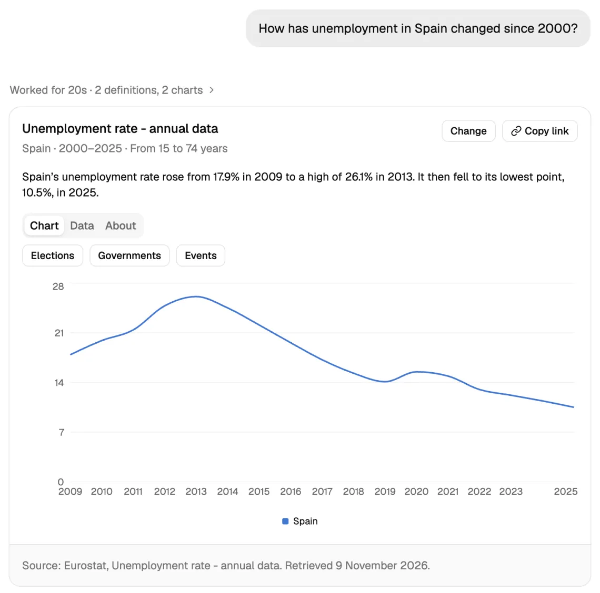

# civicdata

civicdata makes data about the economy and public policy easier to read and understand. You ask a question in your own words, such as "How has unemployment in Spain changed since 2000?", and get a chart of official figures from the World Bank, Eurostat or the OECD, two sentences on what it shows, and the source of every number. It is for people who want to follow how a country is doing without being statisticians.



## What you can do

- Ask about one country or several. The answer is a line over the years, a ranking of countries in one year as bars or a world map, the change between two years, or one indicator plotted against another.
- Read the takeaway: two sentences on what the chart shows. If a number in it doesn't match the chart's data, the answer shows none, and "Explain this chart" asks for another.
- Change the chart where it is: add countries, pick the years, switch the chart type, or show the values per person, as yearly growth, as an index or as a ratio of another indicator. None of these changes calls the assistant.
- Follow up in the same conversation, such as "add Portugal" or "now per person". A follow-up starts from the chart as you last changed it.
- Open About for what the indicator measures, why it matters, its limits, and related indicators to chart instead. Open Data for every value in a table, a CSV download, and a link to the request made to the source.
- On a trend chart of EU and OECD members, turn on Elections, Governments and Events: a mark for each national election, a band for each government, and major events and pension reforms, each with its source.
- See which values a source flags as provisional, estimated or a break in series, and where another source publishes a different figure for the same measure.
- Share a chart with its link. The link opens the same chart, and its preview card shows the chart with its source.
- Go back to an earlier conversation from the sidebar. The list is kept in your browser only, and a conversation is deleted 30 days after its last question.

## How it keeps numbers honest

- Every value on a chart comes from a request to the World Bank, Eurostat or the OECD. A fetched series is reused for a day, or until Eurostat's next twice-daily update.
- The assistant chooses an indicator, countries and years; it never supplies a value. It may only use an indicator code that the catalog search returned, and the server checks the chart it asks for and sends any problem back for it to fix.
- The takeaway is checked number by number. Each number must be a value or a year in the chart's data, rounded the way it is written, or a number in the indicator's name. A takeaway with any other number, such as a difference the model worked out, is not shown.
- A chart's plain title may reword the source's name for the indicator but may not add a number to it, and the official name stays on the chart.
- Every chart, shared link and preview card carries a source line: the publisher, the dataset and the day the data was retrieved.
- An eval asks the assistant 63 questions and checks each chart's type, indicator, countries, transform and years against the answers the case accepts. Maintainers run it by hand before changing the prompt, the tools or the model.
- Elections, governments, events and reforms are dated records, each with its source. The chart shows when they happened beside the data and never says they caused a change: no winner or coalition is read into an election, and the events were ported without the notes on how each may move a chart. The assistant does not see these records, so a takeaway cannot link them to the data.

## Sources and licences

| Source                                                 | What it adds                                                                                             | Licence                                                                                                                     | Credit on the chart                                    |
| ------------------------------------------------------ | -------------------------------------------------------------------------------------------------------- | --------------------------------------------------------------------------------------------------------------------------- | ------------------------------------------------------ |
| World Bank, World Development Indicators               | Indicators for every country, for comparisons across the world                                           | [CC BY 4.0](https://datacatalog.worldbank.org/search/dataset/0037712)                                                       | Publisher, dataset and retrieval date                  |
| Eurostat                                               | Detailed EU and EFTA statistics, split by sex, age and other dimensions                                  | [Reuse with the source acknowledged](https://ec.europa.eu/eurostat/help/copyright-notice) (Commission Decision 2011/833/EU) | Publisher, dataset and retrieval date                  |
| OECD                                                   | Statistics for OECD members, including those outside the EU                                              | [Reuse for any purpose, crediting the dataset](https://www.oecd.org/en/about/terms-conditions.html)                         | Publisher, dataset and retrieval date                  |
| [PPEG 2025v1](https://ppeg.wzb.eu/) (WZB Berlin)       | Cabinets, lower-house and presidential elections of 43 EU and OECD members, to 31 October 2025           | CC0 1.0                                                                                                                     | PPEG (Krause, Döring, Stoppe, WZB Berlin, 2025)        |
| [ParlGov](https://parlgov.fly.dev/) (Döring and Manow) | Cabinets and lower-house elections of 37 members, to June 2023, for the years before PPEG's coverage     | CC0 1.0                                                                                                                     | ParlGov (Döring and Manow, 2024)                       |
| Official pages, checked by hand                        | Cabinets and elections since, 24 major events and 20 pension reforms, in `packages/server/src/official/` | Facts, linked per record                                                                                                    | The government, parliament or electoral authority page |

PPEG and ParlGov ask for no credit under CC0; the chart cites them as they ask to be cited. How the three sets of political records combine is in [docs/catalog.md](docs/catalog.md#political-records).

## Develop

| Path              | What it holds                                                                          |
| ----------------- | -------------------------------------------------------------------------------------- |
| `apps/web`        | TanStack Start app. `src/routes/api/$.ts` hands every `/api` request to Effect         |
| `packages/domain` | Schemas and the `HttpApi` definition, shared by the server and the web client          |
| `packages/server` | Effect `HttpApi` handlers, exposed as a web `handle(request)`                          |
| `packages/infra`  | Alchemy stack: the Worker, D1, R2 and Vectorize. The only package that imports Alchemy |

The app deploys as one Cloudflare Worker. Alchemy builds `apps/web` with its own Cloudflare Vite plugin, so `vite.config.ts` stays free of Cloudflare code.

### Toolchain

- Node 24 and pnpm 12. The pnpm version comes from `packageManager`.
- TypeScript 7 with the Effect language service (`@effect/tsgo`). Effect diagnostics such as `floatingEffect` fail `typecheck`.
- Oxlint with type-aware rules, oxfmt, and Fallow for dead code, duplication and complexity.
- Turborepo runs `typecheck`, `test` and `build` per package.
- Vitest 5 with `@effect/vitest`. Server tests run inside workerd through `@cloudflare/vitest-plugin`, with the same compatibility date as the deployed Worker.

```sh
pnpm install
pnpm dev          # the app in the Workers runtime with local D1 and R2: http://localhost:1337
pnpm dev:web      # the web app alone in Node, no D1 or R2, no Cloudflare login needed
pnpm check        # format, lint, fallow, typecheck, test, build: what CI runs
```

A question on the home page opens a conversation at `/c/<id>`, where follow-ups like "add Mexico" change the last chart. Each conversation lives in its own Durable Object, which runs the agent and keeps the questions and charts until 30 days after the last question. An answer runs to its end and is kept even if the visitor leaves; a visitor who comes back while it runs sees it continue. The id is a random UUID made by the browser; whoever has the link can read the conversation. The agent runs on an OpenAI model. To ask them locally, copy `packages/infra/.env.example` to `packages/infra/.env` (gitignored) and fill in `OPENAI_API_KEY`; `alchemy dev` reads that file when it starts, and a variable exported in your shell overrides it. Set `OPENAI_MODEL` there to try another model than the default in `packages/server/src/Agent.ts`. Without a key the app works and every question answers "The assistant is not available".

`pnpm dev` runs `alchemy dev` for the `dev_<user>` stage. Alchemy emulates D1, R2, Durable Objects and Workflows locally and serves the web app from the Workers runtime with hot reload, so the series cache works as deployed. Local Workflows run no schedules, so the local catalog stays empty and indicator search answers "unavailable" (see [docs/catalog.md](docs/catalog.md)). It needs your Cloudflare login, because the stage's state lives in your Alchemy state store. Vectorize and Workers AI have no local emulation: the stage creates a real Vectorize index in your account, and search by meaning calls Workers AI there. Nothing else is deployed. `pnpm dev:web` needs no login but runs in Node, where there is no D1, R2 or Durable Object: charts load uncached, and indicator search and questions answer "unavailable".

`pnpm install` runs `effect-tsgo patch --typescript`, which patches TypeScript in `node_modules` so the editor loads the Effect plugin. Scripts call `effect-tsgo tsc`, so they don't depend on the patch.

### Agent eval

`pnpm --filter @civicdata/server eval` asks the agent every question in `packages/server/eval/cases.ts` and checks each final chart against the charts the case accepts: chart type, indicator, countries, transform, and the years the question names. A failed case lists what differed, e.g. `indicator GC.DOD.TOTL.CN, want GC.DOD.TOTL.GD.ZS`. It runs in workerd against the live sources and OpenAI, builds the catalog first, reads `OPENAI_API_KEY` and `OPENAI_MODEL` like `alchemy dev` does, and takes about three minutes. CI never runs it, since each question costs a few model requests.

Run it before changing the prompt, the tools or the model, and compare the passed count. A case that fails with `SourceUnavailable` hit a stalled World Bank request, not a wrong answer; rerun it alone with `-t "<question>"`.

### Editor

`.vscode/settings.json` points VS Code at the workspace TypeScript 7. Install the TypeScript 7 extension. Effect diagnostics then show up in the editor.

### Supply chain

`pnpm-workspace.yaml` sets the install policy:

- `minimumReleaseAge: 1440`: pnpm only installs versions that are at least one day old.
- `trustPolicy: no-downgrade`: install fails if a package loses its provenance.
- `blockExoticSubdeps`: no git or tarball URLs deeper in the tree.
- `strictDepBuilds`: install fails on dependency build scripts not listed in `allowBuilds`. Only `workerd` is listed.

### More

- [docs/catalog.md](docs/catalog.md): how the weekly Workflow builds the indicator catalog and stores the political records, and how to rebuild a stage by hand.
- [docs/deploys.md](docs/deploys.md): stages per pull request and for `main`, the one-time setup, deploying your own stage, and upgrading Alchemy.
